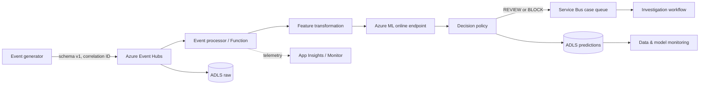

# Real-Time Risk Intelligence on Azure

A production-shaped, industry-neutral platform that turns streaming activity into calibrated risk probabilities, behavioral anomaly scores, explainable decisions, and durable investigation cases. It runs entirely locally, while Azure provides an optional managed streaming, ML, storage, workflow, security, and observability layer.

**Core stack:** Python 3.11 · FastAPI · scikit-learn · Pydantic · Parquet · Azure Event Hubs · Azure ML/MLflow · Functions · Service Bus · ADLS Gen2 · Key Vault · ACR · Application Insights · Terraform



Event Hubs is the high-throughput, partitioned event log and replay boundary. Service Bus is deliberately different: it carries durable, deduplicated business commands requiring completion, retry, and dead-letter handling. It does not duplicate the stream.

## Quick start

```bash
python -m venv .venv
# Windows: .venv\Scripts\activate   macOS/Linux: source .venv/bin/activate
python -m pip install -e ".[dev]"
python -m risk_platform.cli generate --count 5000
python -m risk_platform.cli train
python scripts/run_demo.py
python -m uvicorn risk_platform.inference.api:app --port 8000
```

Then POST to `http://localhost:8000/v1/score`:

```json
{"entity_id":"acct-7","amount":950,"account_age_days":20,"historical_event_count_30d":35,"historical_avg_amount":80,"events_1h":9,"events_24h":18,"is_new_device":true,"is_new_location":false,"recent_failure_rate":0.3,"historical_risk_count":1,"country_code":"US"}
```

The response includes `supervised_risk_probability`, normalized `anomaly_score`, weighted `final_risk_score`, category, `APPROVE`/`REVIEW`/`BLOCK`, reason codes, model version, timestamp, and latency. OpenAPI is at `/docs`. Docker users can run `docker compose up --build` after training.

## ML methodology

Synthetic labels arise from latent pre-event risk factors, never future outcomes. Events are sorted chronologically into 70/15/15 train/validation/test sets. A class-weighted histogram gradient booster is probability-calibrated with cross-validation; Isolation Forest learns normal behavior only. The validation set selects a threshold minimizing configurable `false_negative_cost × FN + false_positive_cost × FP`. The untouched test set reports ROC-AUC, PR-AUC, precision, recall, F1, Brier score, and prevalence in `artifacts/model_bundle.metrics.json`—no fabricated numbers are committed.

PR-AUC and recall matter under rare positives; precision measures investigation load; Brier score checks whether probabilities can support decisions; ROC-AUC remains a ranking diagnostic. The default final score is `0.75 × calibrated_probability + 0.25 × anomaly_score`, making the supervised signal primary while reserving influence for novel behavior. Thresholds are operational policy, configured independently of model training.

Reason codes are deterministic, auditable policy signals. For deeper offline analysis install `[explain]` and apply SHAP to the underlying gradient model. This separation avoids putting an expensive explainer on the synchronous hot path.

## Local architecture and data

The core uses ports for idempotency, prediction storage, and case publishing. Local adapters write JSONL and an append-only processed-ID ledger; Azure adapters use passwordless `DefaultAzureCredential`. Duplicate event IDs return no second prediction or case. Service Bus duplicate detection and `max_delivery_count=10` add broker-level protection; poison messages go to its DLQ for replay after remediation.

Analytical data is Parquet. The intended ADLS layout is:

```text
raw/events/year=YYYY/month=MM/day=DD/hour=HH/
processed/events/year=YYYY/month=MM/day=DD/hour=HH/
features/model_version=.../date=YYYY-MM-DD/
predictions/date=YYYY-MM-DD/hour=HH/
monitoring/date=YYYY-MM-DD/
```

Time partitions bound scans; model-version partitions preserve reproducibility. Avoid entity IDs as partitions because their cardinality is excessive. Raw zones are immutable; corrected representations go to processed zones.

## Monitoring

- Infrastructure: Azure Monitor resource health, saturation, throttling, queue depth, DLQ count.
- Application: App Insights request count, p50/p95/p99 latency, exceptions, dependency failures, correlation IDs.
- Data: schema validity, volume, missingness, ranges, category/cardinality checks.
- Model: probability/action distributions, feature PSI (alert at 0.2), anomaly drift, calibration and business-cost metrics once delayed labels arrive.

Run `python -m risk_platform.cli drift` to create `data/monitoring/drift.json`. Logs must contain pseudonymous IDs, never raw PII or secrets.

## Testing and CI/CD

`make test` exercises feature contracts, schema validation, threshold boundaries, scoring, idempotency, artifact training, and the complete local HTTP path. `make lint` runs Ruff and strict mypy. CI also runs Bandit, validates Terraform, and builds the image. Cloud deployment is manual, environment-protected, OIDC-based, and disabled unless `AZURE_DEPLOYMENT_ENABLED=true`; ordinary CI needs no Azure credentials.

## Azure deployment

```bash
az login
terraform -chdir=infrastructure/terraform init
terraform -chdir=infrastructure/terraform plan -var-file=environments/dev.tfvars
terraform -chdir=infrastructure/terraform apply -var-file=environments/dev.tfvars
# register model/environment and deploy azureml/endpoint.yml + deployment.yml using az ml
terraform -chdir=infrastructure/terraform destroy -var-file=environments/dev.tfvars
```

Terraform creates Event Hubs Standard, Service Bus Standard, ADLS Gen2, Key Vault, ACR Basic, Application Insights/Log Analytics, Azure ML workspace, and a consumption-plan Function with managed identity/RBAC. Azure ML online endpoint compute is deployed separately so infrastructure creation does not accidentally start its largest recurring cost. Configure remote state with a locked Azure Storage backend for teams; the repository keeps backend configuration out so local validation works.

Costs vary by region and traffic. Primary cost drivers are the always-on managed online endpoint, Event Hubs/Service Bus throughput tiers, log ingestion/retention, storage/operations, ACR, and Function executions. Use one small dev deployment, short log retention, autoscaling/zero non-production endpoint capacity where supported, budgets/alerts, and always run `terraform destroy`. Key Vault purge protection intentionally means the vault remains recoverable during retention.

## Security

No connection strings or credentials are stored. Workloads use managed identities and narrowly scoped data-plane RBAC; GitHub uses workload identity federation. Production should add private endpoints, VNet-integrated endpoint/Function access, public-access denial, CMK policy where required, Defender scanning, dependency pin review, secret rotation, egress controls, and immutable audit retention. API input is bounded and rejects unknown fields; logs are PII-aware.

## Repository map

```text
src/risk_platform/      domain, features, training, inference, events, Azure adapters, monitoring
tests/                  unit and end-to-end local integration tests
scripts/                compelling local scenario demo
azureml/                managed endpoint/environment specifications
infrastructure/         Terraform-managed Azure resources
.github/workflows/      quality, security, image, IaC, and gated deployment
docs/decisions/         architecture decision records
```

## Trade-offs and next steps

The local ledger is correct for one process, not distributed concurrency; production should use Cosmos DB/Table Storage conditional writes. The simple weighted policy is transparent but should be governed and back-tested. Synthetic data demonstrates mechanics, not real-world performance. A production extension would add schema registry, Event Hubs Capture, feature-store parity checks, champion/challenger rollout, label joins, fairness slices, autoscaling, private DNS, and automated rollback.

See [architecture decisions](docs/decisions/README.md) for explicit rationale.

